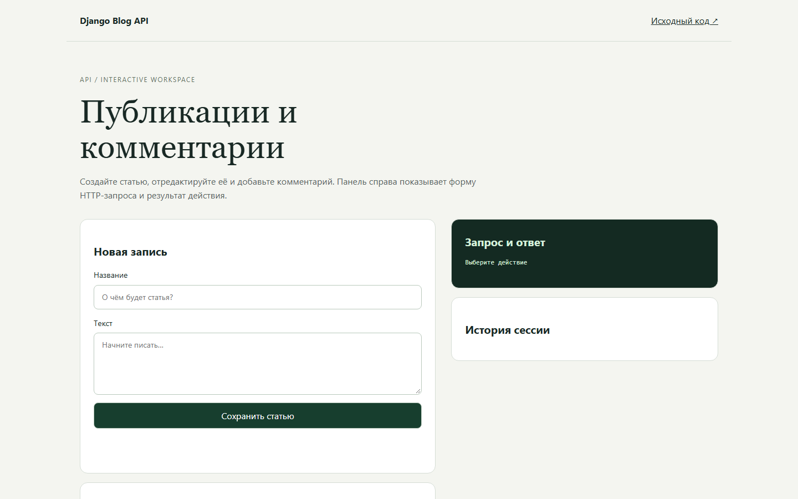
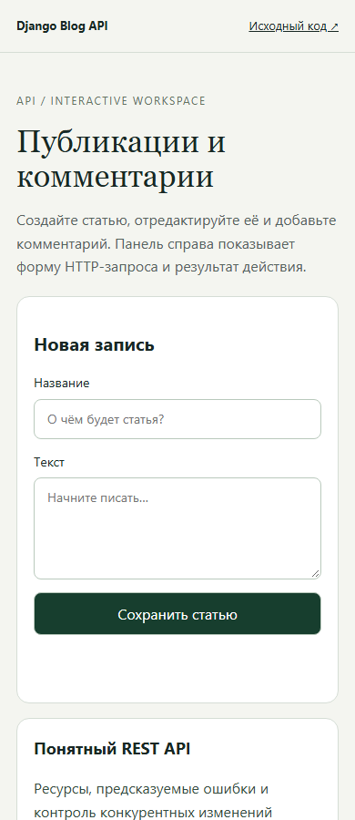

# Django Blog API - публикации и комментарии

REST API пользователей, статей и комментариев с проверкой владельца при изменениях.

[Открыть проект](https://memorim.github.io/django-blog-api/) · [Серверное API](https://memorim-django-blog-api.onrender.com/api/articles)

## Интерфейс





## Возможности

- Регистрация, вход, выход и CRUD статей и комментариев.
- Хешированные токены со сроком действия, ротация и журнал действий.
- ETag/If-Match, постраничная выдача и Django Admin.

## Стек и устройство

Python, Django, Django Ninja, SQLite и PostgreSQL.

## Ключевые решения

- `blog/api.py` проверяет входные поля и владельца записи. Токены хранятся как хеши.
- Записи выполняются транзакционно; PostgreSQL использует блокировку строк. Настройки SQLite и PostgreSQL разделены.
- Миграции и зафиксированная предыдущая версия схемы проверяют сохранность данных при обновлении.

## Локальный запуск

Python 3.12.14, как в `.python-version`. Перед установкой зависимостей активируйте виртуальное окружение.

```bash
python -m venv .venv
# Windows: .venv\Scripts\activate
# Linux/macOS: source .venv/bin/activate
python -m pip install -c requirements-lock.txt -r requirements.txt
python manage.py migrate
python manage.py runserver 127.0.0.1:8000
```

Команда запуска привязывает API к локальному адресу 127.0.0.1.

## Настройки

Доступные параметры перечислены в [.env.example](.env.example). Секреты храните вне Git. Порядок загрузки настроек и необязательные службы описаны в [технической документации](docs/TECHNICAL.md).

## Данные и обновления

Выполните команду миграции из инструкции перед запуском API. Существующие записи сохраняются; тесты проверяют обновление зафиксированной предыдущей версии.

## Проверки

```bash
python manage.py test
python tests/check_contract.py
python tests/check_upgrade.py
python -m pip check
```

Тесты Django проверяют токены, владение, валидацию и условные изменения; дополнительно проверяются OpenAPI и миграции. CI PostgreSQL 16 выполняет конкурирующие PUT/PUT и PUT/DELETE на независимых соединениях.

CI устанавливает зависимости по зафиксированным версиям и запускает настроенные проверки. Отдельная проверка документации находит неверные локальные ссылки и изображения. Проверка уязвимостей учитывает известные проблемы на момент запуска.

## Условия серверного развёртывания

- PUT/DELETE статьи требуют актуальный X-Resource-Version (или сильный ETag) в If-Match: без заголовка возвращается 428, с устаревшим, слабым или wildcard значением — 412. SQLite не реализует блокировки строк PostgreSQL.
- Ограничения API и входа администратора атомарно сохраняются в общей SQL-БД и переживают перезапуск. Перед публичным запуском выполните `python manage.py check --deploy --fail-level WARNING` с настоящими настройками сервера. Нужны HTTPS, корректные hosts/origins и случайный секрет.
- `python tests/check_public_settings.py` проверяет production-настройки в отдельных процессах: HTTPS-redirect, HSTS, защитные заголовки, закрытые API docs, недоверие к proxy-заголовку по умолчанию и отказ при небезопасной конфигурации. CI выполняет эту проверку вместе с PostgreSQL-конкурентностью. Проверка конкретного внешнего TLS-прокси проводится после развёртывания backend; GitHub Pages публикует только демонстрацию.

## Документация

[Результаты аудита](docs/AUDIT_2026_10.md) · [Техническая документация](docs/TECHNICAL.md) · [Пример запроса и ответа](docs/API_EXAMPLE.md) · [Конкурентные проверки PostgreSQL](docs/POSTGRES_CONCURRENCY.md) · [История изменений](CHANGELOG.md)

## Интерактивный просмотр

В браузере можно пройти основной сценарий и увидеть форму запросов и ответов. Изменения хранятся в памяти вкладки и сбрасываются при перезагрузке. Этот просмотр не подключён к серверной БД, токенам и доставке webhook. Для проверки серверных гарантий используйте локальный запуск и автоматизированные тесты выше.

Сборка: `python scripts/build_demo.py`. Проверка: `node --test demo/demo.test.mjs`.

[Проверка опубликованного backend](docs/PUBLISHED_BACKEND_VERIFICATION.md).


## Состояние скриншотов и ограничений

Скриншоты ПК и телефона (`docs/desktop.png` и `docs/mobile.png`) соответствуют опубликованной демонстрации. При изменении цветовой гаммы, вёрстки или другого видимого элемента обновляйте оба файла после загрузки шрифтов и изображений; не включайте токены, содержимое статей и персональные данные.

Бесплатный Render подходит для проверки приложения. Перед рабочим использованием нужно отдельно подтвердить постоянную PostgreSQL-БД, HTTPS, секреты и восстановление после перезапуска.